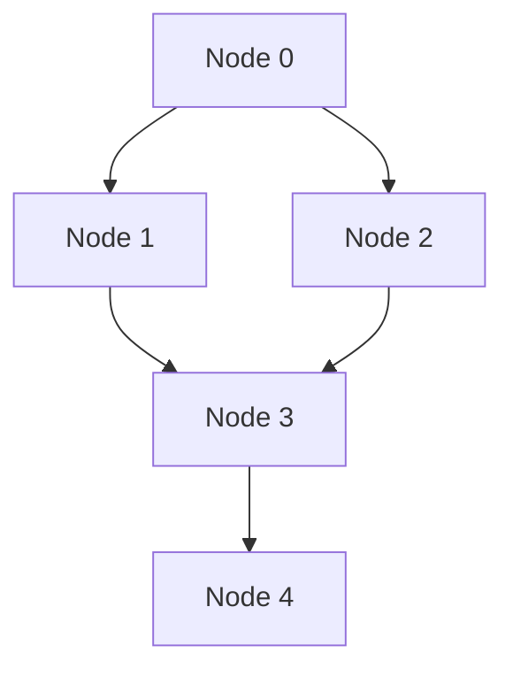
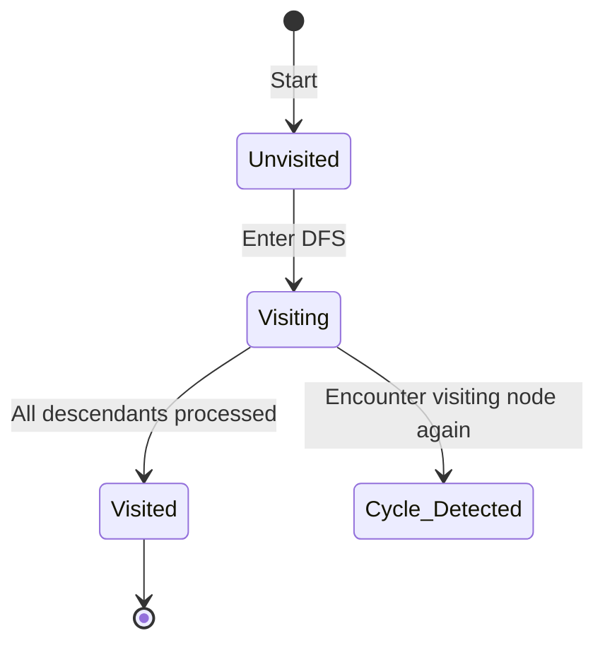

# Topological Sort & Advanced Variations in Python

Topological sorting is a fundamental graph algorithm used to order the vertices of a **Directed Acyclic Graph (DAG)** such that for every directed edge $u \to v$, vertex $u$ comes before $v$ in the ordering. It is commonly used for scheduling jobs, resolving build dependencies, compiling source files, and solving complex ordering problems.

---

## 📊 Overview of Variations

| Variation | Core Strategy | Time Complexity | Space Complexity | LeetCode Examples |
| :--- | :--- | :--- | :--- | :--- |
| **Kahn's Algorithm** | BFS + In-degrees Queue | $O(V + E)$ | $O(V + E)$ | Course Schedule I & II (Medium) |
| **DFS-based Sort** | Post-order DFS + 3-State Coloring | $O(V + E)$ | $O(V + E)$ | Course Schedule I & II (Medium) |
| **Lexicographical Sort** | BFS + Min-Heap (Priority Queue) | $O(V \log V + E \log V)$ | $O(V + E)$ | Sequence Reconstruction (Medium/Hard) |
| **Alien Dictionary** | Custom Graph Construction + Kahn's | $O(C)$ | $O(U + E)$ | Alien Dictionary (Hard) |
| **Parallel Courses** | Level-by-level BFS (Kahn's variation) | $O(V + E)$ | $O(V + E)$ | Parallel Courses (Hard) |
| **DP on DAGs** | Topo Sort + Edge Relaxation | $O(V + E)$ | $O(V + E)$ | Longest Path, Critical Path (Hard) |

---

## 🛠️ Graph Visualization

Here is a visual representation of a DAG and its valid topological sort:

**Valid Topological Sort Orderings:**
- `[0, 1, 2, 3, 4]`
- `[0, 2, 1, 3, 4]`

---

## 1. Kahn's Algorithm (BFS)

Kahn's algorithm is an intuitive, BFS-based approach that maintains an **in-degree** count for each node (the number of incoming edges).

### How it works:
1. Calculate the in-degree of all vertices.
2. Place all vertices with an in-degree of `0` in a Queue.
3. While the Queue is not empty:
   - Pop a node $u$ from the Queue and add it to the topological order.
   - For each neighbor $v$ of $u$, decrement its in-degree by 1.
   - If $v$'s in-degree becomes `0`, push it into the Queue.
4. If the size of the topological order is less than the total number of nodes, the graph contains a **cycle**, and topological sorting is impossible.

> [!NOTE]
> Kahn's algorithm is highly preferred when you need to detect cycles explicitly and process nodes level-by-level.

---

## 2. DFS-based Topological Sort (3-State Coloring)

The DFS-based approach uses recursion and detects cycles by tracking the traversal state of each node using three colors/states:
* **`0 (Unvisited)`**: Node has not been visited yet.
* **`1 (Visiting)`**: Node is in the current recursion stack. If we encounter a node in this state, a **cycle exists**.
* **`2 (Visited)`**: Node and all its descendants have been fully processed.

### State Transitions:

### How it works:
1. Run DFS starting from each unvisited node.
2. In the recursive call:
   - Mark the node as `Visiting`.
   - Traverse all neighbors. If a neighbor is already in `Visiting` state, a cycle is found.
   - After traversing all neighbors, mark the node as `Visited` and append it to a post-order list.
3. The final topological sort is the **reverse** of the post-order list.

---

## 3. Lexicographical Topological Sort (Min-Heap)

When multiple topological sort orders are valid, some problems require you to return the **lexicographically smallest** order. 

Instead of using a standard Queue in Kahn's algorithm, we use a **Min-Heap (Priority Queue)**. At any step where multiple independent nodes (in-degree = 0) can be processed, the heap ensures the node with the smallest identifier is processed first.

---

## 4. LeetCode Hard: Alien Dictionary

This problem presents words sorted lexicographically in an unknown language. We must deduce the character order.

### Graph Construction Strategy:
1. Collect all unique characters to represent the vertices.
2. Compare adjacent words $W_i$ and $W_{i+1}$ character-by-character.
3. At the first index where $W_i[j] \neq W_{i+1}[j]$, we establish a dependency: $W_i[j] \to W_{i+1}[j]$ (i.e., $W_i[j]$ must come before $W_{i+1}[j]$). Stop comparing further characters for this word pair.
4. Perform topological sorting.

> [!WARNING]
> **Edge Case:** If $W_i$ is a prefix of $W_{i+1}$ (e.g. `["abc", "ab"]`), it violates lexicographical sorting standards. In this case, the dictionary is invalid, and you must return `""`.

---

## 5. LeetCode Hard: Parallel Courses (Level-by-Level)

Given a dependency graph of courses, find the minimum number of semesters needed to complete all courses. You can take any number of courses in parallel if their prerequisites are completed.

### Level-by-Level BFS:
1. Perform Kahn's algorithm.
2. Instead of processing nodes one-by-one, process nodes in batches (levels) by checking the size of the queue at the start of each iteration.
3. Each batch representing a level corresponds to a semester.
4. Increment the semester counter after processing each batch.

---

## 6. LeetCode Hard: DP on DAGs (Longest Path)

In a weighted Directed Acyclic Graph, we can find the longest path (or shortest path) in $O(V + E)$ time using dynamic programming. This is enabled because topological sorting guarantees that when we process node $u$, all predecessors of $u$ have already been processed and their distances finalized.

### DP State Transition:
Let $dist[v]$ be the longest path ending at node $v$. For all edges $u \to v$ with weight $w$:
$$dist[v] = \max(dist[v], dist[u] + w)$$

By keeping track of a `parent` pointer, we can reconstruct the exact path backwards.
